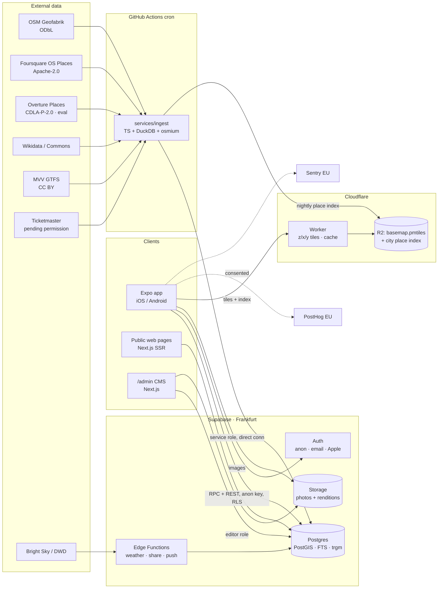

# 089 — Architecture

_Written 2026-10-28. Prices checked on the providers' pricing pages that day (USD, excl. VAT). Re-check before committing money; record changes in `DATA_SOURCES.md` / `DECISIONS.md`._

## 1. Final stack

| Layer                         | Choice                                                                                                                      | Why (and what I rejected)                                                                                                                                                                                                                                              |
| ----------------------------- | --------------------------------------------------------------------------------------------------------------------------- | ---------------------------------------------------------------------------------------------------------------------------------------------------------------------------------------------------------------------------------------------------------------------- |
| Monorepo                      | **pnpm workspaces + Turborepo**                                                                                             | One repo for app, web, ingestion, shared schemas. Turborepo caches lint/typecheck/test. (Nx: more power than we need.)                                                                                                                                                 |
| Mobile app                    | **Expo (latest SDK at scaffold time), dev builds, EAS, Expo Router, TypeScript strict**                                     | Spec default. Native maps need dev builds anyway. New Architecture on.                                                                                                                                                                                                 |
| Server state                  | **TanStack Query** + persisted cache (kv-store persister)                                                                   | Gives offline-tolerant reads for free.                                                                                                                                                                                                                                 |
| Client state                  | **Zustand** (small: filters, map camera, onboarding flags)                                                                  | Spec default. Keep it tiny; server data never goes in Zustand.                                                                                                                                                                                                         |
| Local storage                 | **`expo-sqlite/kv-store`** (or AsyncStorage)                                                                                | Persisted query cache and preferences. Chosen over react-native-mmkv because it is included in Expo Go (ADR-025).                                                                                                                                                      |
| Validation                    | **Zod** in `packages/core`, shared by app, web, ingestion                                                                   | Same schema validates CMS input, API responses and the category attribute schemas.                                                                                                                                                                                     |
| Styling                       | **React Native `StyleSheet` + typed theme hooks over `@089/tokens`** (ADR-025)                                              | Keeps the app runnable in **Expo Go** until launch (free iPhone testing without an Apple Developer account). Unistyles v3 (ADR-005) was the first choice but is a native module Expo Go doesn't include. Revisit after launch if theme switching performance needs it. |
| Animation / gestures / sheets | Reanimated, Gesture Handler, `@gorhom/bottom-sheet`                                                                         | Spec default.                                                                                                                                                                                                                                                          |
| Icons                         | **lucide-react-native** (ISC)                                                                                               | One consistent, broad, tree-shakeable set. Same set on web (`lucide-react`).                                                                                                                                                                                           |
| Font                          | **Inter** (OFL), with tabular figures for times/prices                                                                      | Full German glyph coverage, good at small sizes, dynamic type friendly.                                                                                                                                                                                                |
| Images                        | **expo-image**; renditions made at upload time                                                                              | CMS creates 400/800/1600px WebP + blurhash with `sharp` when uploading, stored in Supabase Storage (served from its CDN). No per-request transformation billing; predictable cost.                                                                                     |
| Maps                          | **@maplibre/maplibre-react-native** + self-hosted **Protomaps** basemap                                                     | See §3. No per-map-load fees, our own style, no Google lock-in.                                                                                                                                                                                                        |
| Backend                       | **Supabase, region eu-central-1 (Frankfurt)**: Postgres + PostGIS + pg_trgm + unaccent, Auth, Storage, Edge Functions       | Spec default. RLS on every table. Everything is plain Postgres/S3, so we can move off it.                                                                                                                                                                              |
| Search                        | Postgres full-text search (custom `de_unaccent` / `en_unaccent` configs) + `pg_trgm`                                        | Enough for ~10k places + events. Move to Typesense/Meilisearch only when p95 > 150 ms or we need facets at scale.                                                                                                                                                      |
| Ingestion                     | **TypeScript worker in `services/ingest`, run by GitHub Actions cron**; DuckDB for parquet, osmium for OSM PBF              | Edge Functions have wall-clock limits unsuited to bulk imports. Actions gives logs, retries and secrets for free/cheap. Move to a small Fly.io/Hetzner box if runs exceed ~30 min.                                                                                     |
| Public web + admin CMS        | **One Next.js app (`apps/web`)**: public SSR pages (`/p/[slug]`, `/e/[slug]`, `/l/[shareId]`) + `/admin` behind editor role | Share links need web pages for people without the app, and those pages are SEO. One deployment, one design-token package.                                                                                                                                              |
| Web hosting                   | **Vercel Pro**, functions pinned to `fra1`                                                                                  | Easiest Next.js hosting; DPA available. Alternative: Cloudflare with OpenNext.                                                                                                                                                                                         |
| Weather                       | **Bright Sky** (DWD open data, CC BY 4.0) via an Edge Function that caches into `weather_snapshots` every 30 min            | Clients never call Bright Sky directly. One request per 30 min regardless of user count.                                                                                                                                                                               |
| Push                          | Expo Notifications                                                                                                          | Opt-in only. Payloads hold no personal data beyond what is needed.                                                                                                                                                                                                     |
| i18n                          | i18next + expo-localization (app), next-intl (web). Content translations stored in DB as `jsonb`                            | de + en from day one.                                                                                                                                                                                                                                                  |
| Analytics                     | **PostHog EU Cloud**, consent-gated, no autocapture, an explicit event list                                                 | 1M events/month free. Verify data-centre location at slice 12.                                                                                                                                                                                                         |
| Errors                        | **Sentry** (EU data residency), PII scrubbing on                                                                            | Free tier at the start.                                                                                                                                                                                                                                                |
| CI/CD                         | GitHub Actions (lint, typecheck, unit, DB tests with `supabase start`) + EAS Build/Submit/Update                            | Spec default.                                                                                                                                                                                                                                                          |

## 2. System diagram



## 3. Map architecture

- **Basemap:** download the Protomaps OSM build, cut it to Bavaria + the Alps day-trip region (`pmtiles extract`), upload to **Cloudflare R2**, serve as `/{z}/{x}/{y}.mvt` through the Protomaps Cloudflare Worker with a long cache TTL. Style built from `protomaps/basemaps` themes, in two variants (dark and light) matching our tokens. Fonts/glyphs and sprites on R2 too. Update monthly.
  - If `pmtiles://` is supported natively by the MapLibre RN version we pin, we can skip the Worker. **Check at slice 7.**
- **Place layer:** the ingestion job writes `places-<city>.geojson.gz` (id, lon, lat, primary category, tier, name) to R2 nightly. The app fetches it with an ETag, caches it, and renders it as a clustered GeoJSON source. Category filtering is a client-side expression filter. Tapping a pin loads the full place preview by id.
- **Events layer:** events don't fit a static file (they're time-bound), so they come from a viewport/date RPC (`events_in_bbox(bbox, from, to)`).
- **"Search this area"** calls `search_places(q, bbox)`.
- **Directions:** deep links to Apple Maps / Google Maps (transit mode) and MVV. Nearest stops come from the GTFS `stops` table.

## 4. Cost estimates (monthly, USD)

**Assumptions:** per MAU per month: ~8 sessions, ~4 map opens, ~250 vector tiles (after on-device caching), ~120 analytics events (explicit list, no autocapture, sampled above 10k MAU), ~40 MB of image/API egress. Single city. These are estimates, not quotes.

| Item                                           | 1k MAU     | 10k MAU                      | 100k MAU                                                                                                               | Notes                                                                                                                           |
| ---------------------------------------------- | ---------- | ---------------------------- | ---------------------------------------------------------------------------------------------------------------------- | ------------------------------------------------------------------------------------------------------------------------------- |
| Supabase                                       | 25         | 40–75 (Small/Medium compute) | 300–500 (Large compute $110; ~4 TB egress → ~3.75 TB overage at $0.09/GB ≈ $340, less if images move to a cheaper CDN) | Free tier is not for production: no backups, pauses when idle. Pro includes 100k MAU, 250 GB egress, 8 GB DB.                   |
| Basemap — self-hosted Protomaps on R2 + Worker | ~0–5       | ~5                           | ~20–40                                                                                                                 | R2 has no egress fees. Workers paid plan $5 + requests. Edge cache absorbs most tile requests.                                  |
| _(comparison: MapTiler Flex)_                  | _(30)_     | _(~120)_                     | _(~1,000+)_                                                                                                            | $30 incl. 25k map sessions, then $2.50/1k. Free plan is non-commercial.                                                         |
| _(comparison: Stadia Maps)_                    | _(20)_     | _(~80)_                      | _(~250–500)_                                                                                                           | Credits per tile. Free plan non-commercial.                                                                                     |
| Vercel (web + admin)                           | 20         | 20                           | 20–60                                                                                                                  | Pro per seat. SSR page caching keeps function usage low.                                                                        |
| EAS                                            | 0–19       | 19                           | 199 (+ update MAU)                                                                                                     | Free: 15+15 builds/month, updates for 1k MAU. At 100k MAU OTA updates cost ~$250 more; consider limiting OTA to critical fixes. |
| Sentry                                         | 0          | 26                           | 80                                                                                                                     | Developer free → Team → Business.                                                                                               |
| PostHog (EU)                                   | 0          | 0                            | ~150–350                                                                                                               | 1M events free, then $0.00005/event (1–2M), $0.0000343 (2–15M). Keep the event list small.                                      |
| GitHub Actions (ingestion + CI)                | 0          | 0–10                         | 10–20                                                                                                                  | Private repo minutes beyond the free allowance.                                                                                 |
| Bright Sky, OSM, FSQ OS, GTFS, Wikidata        | 0          | 0                            | 0                                                                                                                      | Open data. Donate to Bright Sky/OSMF once we earn money.                                                                        |
| Domain, email, misc                            | ~10        | ~10                          | ~20                                                                                                                    |                                                                                                                                 |
| **Total (self-hosted maps)**                   | **~60–80** | **~130–200**                 | **~800–1,500**                                                                                                         | Plus Apple Developer $99/yr, Google Play $25 once.                                                                              |

The biggest cost risk is per-map-session pricing (avoided by self-hosting). The second is image egress (mitigated by renditions + `expo-image` disk cache).

## 5. Folder structure

```
089/
├─ apps/
│  ├─ mobile/                 # Expo app
│  │  ├─ app/                 # Expo Router routes (see APP_STRUCTURE.md)
│  │  ├─ src/
│  │  │  ├─ features/         # explore/, map/, place/, events/, saved/, search/, settings/
│  │  │  │  └─ <feature>/     # components/, hooks/, api.ts (queries), *.test.ts
│  │  │  ├─ design/           # theme hooks, components/ (Button, Chip, PlaceCard…), gallery
│  │  │  ├─ lib/              # supabase client, query client, i18n, analytics, location
│  │  │  └─ locales/          # de.json, en.json
│  │  └─ app.config.ts
│  └─ web/                    # Next.js: public pages + /admin CMS
│     ├─ app/(public)/        # /p/[slug], /e/[slug], /l/[shareId], legal pages
│     ├─ app/admin/           # places, editorial, media, events, collections, reports, review queues
│     └─ src/
├─ packages/
│  ├─ core/                   # zod schemas, domain types, opening-hours eval, ranking rules, slug utils
│  ├─ tokens/                 # design tokens (TS) → consumed by mobile theme + web CSS variables
│  ├─ db/                     # generated Supabase types, typed RPC wrappers
│  └─ config/                 # shared tsconfig, eslint, prettier
├─ services/
│  └─ ingest/                 # sources/{osm,fsq,overture,wikidata,gtfs,ticketmaster}/, match/, quality/, publish/
├─ supabase/
│  ├─ migrations/             # ordered, hand-written SQL
│  ├─ functions/              # edge functions: weather-refresh, share-render, push-send
│  ├─ tests/                  # pgTAP: RLS + RPC tests
│  └─ seed/                   # categories.sql (real taxonomy), fixtures.sql (local only: "Test Place 1"…)
├─ infra/
│  └─ tiles/                  # pmtiles extract script, map styles (dark/light), worker config
├─ docs/
├─ .github/workflows/         # ci.yml, ingest-nightly.yml, ingest-weekly.yml, eas-build.yml
├─ CLAUDE.md
└─ turbo.json / pnpm-workspace.yaml
```

## 6. Cross-cutting rules

- **Secrets:** only the Supabase anon key and public tile URL are in the app. The service role key exists only in GitHub Actions secrets, Vercel server env and Edge Function env. `.env.example` lists every variable; `.env*` is gitignored.
- **Environments:** `local` (supabase CLI + fixtures), `staging` (separate Supabase project, real data), `production`. EAS channels map to them.
- **API style:** tables for simple reads (RLS-guarded), **Postgres RPC functions** for anything with ranking/geo/time logic (`explore_sections`, `search_all`, `events_in_bbox`, `place_detail`). RPCs are typed via generated types + zod at the edge.
- **Time:** every timestamp is `timestamptz`. "Open now" and "this weekend" are evaluated in the city's timezone (`Europe/Berlin`), never the device's.
- **Performance budgets:** cold start to interactive Explore < 2.5 s on a mid-range Android (e.g. Pixel 6a class); place page < 1 s from cache, < 2 s from network; map at 60 fps with 10k points clustered.
- **Observability:** ingestion runs write to `ingest_runs` (source, counts inserted/updated/skipped/flagged, duration, errors), shown in /admin.
